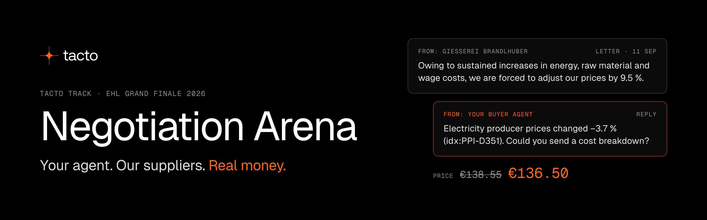

<p align="center">
  
</p>

<p align="center">
  <a href="https://arena.tacto.ai/apply"><b>Apply for your key</b></a> ·
  <a href="brief/brief.md">Brief</a> ·
  <a href="brief/api.md">API docs</a> ·
  <a href="starter-kit/">Starter kit</a> ·
  <a href="https://arena.tacto.ai/live">Build page</a> ·
  <a href="https://arena.tacto.ai/results">Results</a> ·
  <a href="https://discord.gg/hPwFfbWRV">Discord</a>
</p>

You are the procurement team of Hollerau Pumpenwerke, a fictional German pump maker, and the inbox is
full: a foundry wants +9.5 %, a framework contract expires, a new pump needs three quotes. Build an
**AI buyer agent** that reads the company's data, negotiates by e-mail with our supplier bots, and
closes the best total deal, or walks away. Practise all weekend against our hosted suppliers. On
Sunday at 12:00 a Live Final on hidden cases ranks every team.

This repo holds everything you need: the brief, the API docs, a Python starter kit and the data
package. Bring your own LLM, any provider; we run the suppliers.

## Our solution: Hello World Buyer

Implemented: a buyer that researches suppliers, negotiates complete commercial packages, and
accepts only deals that satisfy the case's requirements and beat or match its alternative.
`buyer` runs without an LLM; `buyer-llm` uses a model to choose evidence and answer supplier objections.
Both compute prices, claims and acceptance checks in Python.

**The problem:** a cheap unit price can hide expensive freight, early payment, uncovered demand,
poor quality or an unsustainable supplier relationship. The challenge rewards the total cost of
covering the full need, with supplier-specific arguments and strict reply deadlines.

**The solution:** research the supplied notes, contracts, market indices and supplier history;
compute citable figures; search the allowed terms for good packages; negotiate RFQ threads
concurrently; compare the complete standing offers before accepting or walking away. Every
decision has a private explanation available with `-v`. The planner trades payment, duration,
indexation and quality liability, and avoids demanding extra supplier effort when it adds no
value under the case's cost function.

Run the complete local comparison without API keys, a model or a running server:

```bash
cd starter-kit
uv sync --extra sim
uv run arena benchmark --data ../data --out /tmp/arena-benchmark.json
uv run pytest
uv run ruff check .
```

After installation, `.venv/bin/arena`, `.venv/bin/pytest` and `.venv/bin/ruff` also work directly.

| Local case | Starter score | Buyer score |
|---|---:|---:|
| S01: price negotiation | 0.521 | 0.888 |
| S02: competing quotes | 0.513 | 0.886 |
| S03: framework renewal | 0.678 | 0.927 |

These are results against the supplied scripted simulator. Hosted experiments now cover all ten
practice case types. On five matched cases, the observed mean rose from **0.583 to 0.620**.
The complete ten-case batch averaged **0.559**, including one failed acceptance; later targeted
runs tested settlement fixes and quality alternatives. Results vary between runs and versions.

Use the [negotiation strategy](docs/strategy.md) for the operating playbook, and the
[evaluation report](docs/evaluation.md) for all experiment summaries, limitations and replay links.

The [later local optimization](docs/local-score-optimization.md) adds a 48-case development suite
and 48-case parameter holdout. The [equal-value package strategy](docs/package-exchange-validation.md)
improved the paired holdout mean from **0.816 to 0.834**, with no errors or requirement breaches.
The subsequent [competition policy](docs/competitive-strategy-validation.md) reached **0.843** locally.
Its corrected hosted P05 run scored **0.459**, a small gain over 0.452 after one failed experiment;
these synthetic scores do not predict hosted performance. Run it without
keys, network or a model from `starter-kit`:

```bash
.venv/bin/python -m arena_kit.stress --split holdout --out /tmp/local-holdout.json
```

For hosted practice, set `ARENA_URL` and `ARENA_API_KEY` in `starter-kit/.env`, then run:

```bash
uv run arena play case:P01 --agent buyer --data ../data -v
```

To test all hosted practice cases once and save scores, claim checks and replay links:

```bash
uv run arena evaluate --agent buyer-llm --data ../data --parallel 5 \
  --out /tmp/arena-evaluation.json
```

This uses one practice session per case. Add `--cases case:P05 case:P10 case:P11` for a smaller
experiment. Errors count as zero in the reported average; the report records the code fingerprint.

For the AI mode, also configure `LLM_PROVIDER`, `LLM_MODEL` and the provider's key; Anthropic users
install `uv sync --extra sim --extra anthropic`. Run with `--agent buyer-llm`. The final command is:

```bash
uv run arena run --set final --agent buyer-llm --data ../data --parallel 10 -v
```

Before the final, refresh the Sunday data with `uv run arena data --out ../data`. Research is
loaded when the runner starts, so download the release before starting it. The agent uses the
existing wave runner and reads only its cases, sessions and attachments.

Read the [implementation and configuration guide](docs/solution.md), the [strategy](docs/strategy.md), and the
[pitch slides](docs/pitch.md). The original challenge instructions follow below; its examples
using `--agent naive` or `--agent llm` remain available. `buyer` is now the default agent.

## Start in 15 minutes

You need Python 3.12, [uv](https://docs.astral.sh/uv/) and git.

1. **Apply.** Open **https://arena.tacto.ai/apply** and enter your team name and a contact e-mail.
   Tip: start the name with one emoji, it shows on the big screen.
2. **Show your match code at the Tacto desk.** We approve.
3. **Copy your key.** It appears **once** on the page you applied on; then press "Got the key". One key
   per team. Lost it? We reset it at the desk.
4. **Run the four commands.**

```bash
git clone https://github.com/tacto-ai/negotiation-arena-kit.git
cd negotiation-arena-kit/starter-kit
cp .env.example .env            # paste your key: ARENA_API_KEY=...

uv sync --all-extras            # install
uv run arena me                 # your team and its practice quota
uv run arena play case:P01 --agent naive  # the original baseline negotiates one practice case
uv run arena board              # your team on the practice leaderboard
```

`arena play` prints the deal, your score and a replay link: every e-mail and the supplier's reasons
in words. Read it, improve your agent, play again. Next steps, the LLM agent and your own agent:
[starter-kit/README.md](starter-kit/README.md).

## Links

| What | Where |
|---|---|
| Apply for your key | https://arena.tacto.ai/apply |
| Brief: story, task, score, rules | [brief/brief.md](brief/brief.md) |
| API docs | [brief/api.md](brief/api.md) |
| Starter kit: client, example agents, Live Final runner, local simulator, MCP server | [starter-kit/](starter-kit/) |
| Submission and pitch | [brief/submission.md](brief/submission.md) |
| Practice build page: every team's quota, records and highlights | https://arena.tacto.ai/live |
| Live Final results, team by team and case by case | https://arena.tacto.ai/results |
| Questions | Discord https://discord.gg/hPwFfbWRV · the Tacto table |

## The weekend at a glance

| When | What |
|---|---|
| Sat 10:00 | Kickoff and reveal: brief, data, kit and practice arena go live |
| Sat 12:00-13:00 | **Deep dive**, ground floor (room on the signs): data, API, kit, Q&A. Bring a laptop. Challenge selection closes 13:00 |
| Sat afternoon | Office hours at the Tacto table. Practice all weekend: 200 sessions per team per 24 hours |
| Sat evening | We post on Discord when Tacto goes offline for the night |
| Sun 08:00 | **New market data.** Run `uv run arena data` again; hidden cases may cite it |
| Sun 09:00 | Pre-flight: one practice case through your final setup |
| Sun 12:00 | **Code freeze**, submit on ehl.gg. **Live Final**: five waves, 8 minutes each, every team at once |
| Sun 13:00 | **Top 10 pitch** to the Tacto jury: 5 minutes + 2 minutes of questions |
| Sun 14:30 | Track winners and the two finalists announced |
| Sun 15:30 | Grand Final pitches (AudiMax) |
| Sun 16:30 | Awards |

## Rules that matter

- **No human in the loop** during the Live Final. Start your agent before 12:00 and leave it running:
  `uv run arena run --set final --agent llm --parallel 10` picks up each wave by itself.
- **Your agent must not read the live feed** during the Live Final: `/v1/events`, `/screen`,
  `/leaderboard`, `/results` and their JSON. They are for you, not for your agent.
- **One key per team.** No attacks on the service or on other teams.
- Everything else counts, including weaknesses you find in our suppliers. Every replay is open to
  the jury.

All rules: [brief, section 7](brief/brief.md#7-rules).

## What to submit on ehl.gg by Sun 12:00

- **Your repo** with the agent and a README that says how to run it, and the **commit hash** your
  agent runs in the final. The jury and tum.ai must be able to open it.
- **A short description** of your approach.
- **Slides** for the pitch. The top 10 pitch from 13:00.

Details: [brief/submission.md](brief/submission.md).

## Prizes

1st place €1,500 · medals for the top 3 · the best 2 EHL finalist teams in this track go on to the
Grand Final. ⟦Q2: how the Live Final score and the jury combine for places 1-3⟧

## What is in this repo

| Folder | What |
|---|---|
| [`brief/`](brief/) | The brief, the API docs, the submission guide |
| [`starter-kit/`](starter-kit/) | Python client, a naive and an LLM example agent, the Live Final runner, `arena-sim` (the API on your laptop), an MCP server over the data |
| [`data/`](data/) | Data package v1: CSV, SQLite, `facts.json`, contracts, letters, notes. The same as `https://arena.tacto.ai/v1/data/package.zip`; start with [`data/README.md`](data/README.md) |

The company, its suppliers and all names are fictional; the market indices are real open series
([`data/ATTRIBUTION.md`](data/ATTRIBUTION.md)).

## Licence

Code: MIT ([LICENSE](LICENSE)). Data and docs: CC BY 4.0 ([LICENSE-data](LICENSE-data)). Your code
is yours.

<br>
<p align="center"><sub>Tacto · AI for industrial procurement · EHL Grand Finale 2026, Garching</sub></p>
